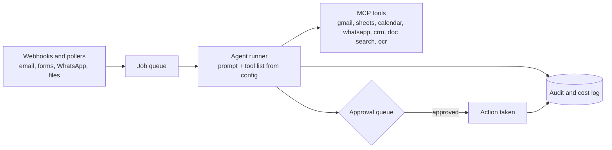

# Backoffice Agents

Four AI agents that take repetitive admin off a small business, built on one shared platform with an approval queue and an audit log. Nothing is sent, booked or written outside the app until a person approves it.

> **Status:** in development (Nov 2026). This README is the build plan; each agent's section fills in as it ships. All demos run on made-up business data.

## The agents

| # | Agent | What it does | Waits for approval before |
|---|---|---|---|
| 1 | **Inbox triage** | Sorts incoming email (lead, support, invoice, spam), extracts the key fields, drafts a reply and logs it to a sheet | Sending a reply |
| 2 | **Lead enrichment** | Takes a form entry or CSV, researches the company's site, scores the lead against a rubric and drafts a first email | Sending the email |
| 3 | **WhatsApp assistant** | Answers customer questions from the business's own documents with citations, books calendar slots and hands off to a human when unsure | Bookings outside the rules |
| 4 | **Invoice extractor** | Turns PDFs and photos into validated rows, and flags duplicates and totals that do not add up | Rows that fail validation |

## Shared platform

Each tool is written once as an MCP tool and reused by every agent. Each agent is a config file: a prompt, a tool list and its approval rules.

## Evals

| Agent | Measured |
|---|---|
| Inbox triage | Classification accuracy, field extraction accuracy |
| Lead enrichment | Agreement between the agent's score and hand labels |
| WhatsApp assistant | Answer faithfulness, correct handoff rate |
| Invoice extractor | Field-level extraction accuracy, duplicates caught |

## Safety

Least-privilege tokens (draft, not send, until approved) · inbound messages and documents treated as data, never as instructions · webhook signatures verified · personal data redacted from logs · every tool call recorded

## Stack

Python · FastAPI · Claude API (tool use, structured outputs, vision) · MCP · Postgres with pgvector · n8n versions of each flow · Docker · GitHub Actions

Architecture, repository structure and database plan: [docs/ARCHITECTURE.md](docs/ARCHITECTURE.md)

---
Mariyam Pangarkar · [LinkedIn](https://linkedin.com/in/mariyam-pangarkar) · [Portfolio](https://mariyampangarkar19.github.io)
