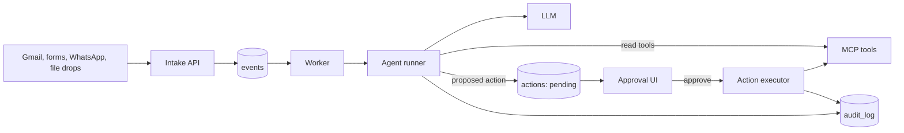

# Backoffice Agents: architecture

Status: locked for v1 (Nov 2026). Changes go through a short decision record in `docs/decisions/`.

## Principles this design follows

1. **Separation of concerns.** HTTP handling, business logic, LLM calls and data access live in separate layers. A route never talks to the database or the model directly.
2. **Dependencies point inward.** `domain` knows nothing about FastAPI, Postgres or any LLM vendor. Outer layers (API, adapters) depend on inner ones, never the reverse.
3. **Ports and adapters.** Every external system (database, LLM, third-party API) sits behind a small interface, so it can be swapped or faked in tests.
4. **The LLM is an untrusted component.** Its output is validated by ordinary code before anything acts on it. Safety rules are enforced in code, not in prompts.
5. **Stateless services, state in the database.** Any process can be restarted or scaled without losing work.
6. **Idempotent writes.** Reprocessing the same input never creates duplicates.
7. **Observable by default.** Every request and every model or tool call is logged with latency and cost.
8. **Start as a modular monolith.** One deployable service with clear module boundaries; split out a service only when a real need appears.

Two more that matter specifically here:

9. **Agents propose, people dispose.** An agent can only *request* a side-effecting action. A separate executor performs it after approval.
10. **An agent is configuration.** Adding an agent means adding a config file and maybe a tool, not new platform code.

## Technology decisions

| Layer | Choice | Why |
|---|---|---|
| Language | Python 3.12 | Shared with the other projects |
| API and webhooks | FastAPI | Async, typed |
| Agent loop | Plain Python tool-use loop on the Claude API | Small, readable, easy to explain |
| Tools | MCP servers (one per integration) | Written once, reused by every agent and by other projects |
| Queue | Postgres table with `FOR UPDATE SKIP LOCKED` | No Redis to run in v1; transactional with the data |
| Database | PostgreSQL 16 with pgvector | Events, actions, audit and document search in one place |
| Approval UI | Next.js (TypeScript), small and server-rendered | One page: pending actions |
| No-code twin | n8n workflow export per agent in `n8n/` | Clients often want to own the flow |
| Delivery | Docker Compose (api, worker, db), GitHub Actions | One command per client deployment |

## System context



Tools are split into **read tools** (search, fetch, look up), which the agent may call freely, and **write tools** (send, book, create), which the agent can only propose.

## Repository structure

```
backoffice-agents/
  platform/
    api/              # intake webhooks, approvals API
    domain/           # Event, Action, ApprovalPolicy, AgentConfig
    runner/           # agent loop, tool registry, read/write split
    executor/         # performs approved actions
    queue/            # enqueue, claim, retry with backoff
    adapters/
      llm/
      repo/
    core/
  tools/              # MCP servers: gmail, sheets, calendar, whatsapp, crm, web_fetch, doc_search, ocr
  agents/
    inbox_triage/     # agent.yaml, prompt.v1.md, schemas.py, evals/
    lead_enrichment/
    whatsapp_assistant/
    invoice_extractor/
  clients/            # one config per deployment (demo bakery, demo clinic)
  approval-ui/
  n8n/
  migrations/
  tests/
  docs/
  infra/
```

An `agent.yaml` declares the trigger, the prompt version, the output schema, the allowed read tools, the write tools it may propose and its approval policy.

## Database plan

```sql
CREATE TABLE clients (
  id            uuid PRIMARY KEY DEFAULT gen_random_uuid(),
  name          text UNIQUE NOT NULL,
  config        jsonb NOT NULL,
  created_at    timestamptz NOT NULL DEFAULT now()
);

CREATE TABLE credentials (
  client_id     uuid NOT NULL REFERENCES clients(id) ON DELETE CASCADE,
  provider      text NOT NULL,               -- gmail, whatsapp, calendar
  secret_encrypted bytea NOT NULL,
  scopes        text[] NOT NULL,
  PRIMARY KEY (client_id, provider)
);

CREATE TABLE events (                        -- everything that arrives
  id            uuid PRIMARY KEY DEFAULT gen_random_uuid(),
  client_id     uuid NOT NULL REFERENCES clients(id),
  agent         text NOT NULL,
  source        text NOT NULL,
  external_id   text NOT NULL,               -- message id from the source
  payload       jsonb NOT NULL,
  status        text NOT NULL DEFAULT 'queued'
                CHECK (status IN ('queued','running','done','failed')),
  attempts      smallint NOT NULL DEFAULT 0,
  run_after     timestamptz NOT NULL DEFAULT now(),
  received_at   timestamptz NOT NULL DEFAULT now(),
  UNIQUE (client_id, source, external_id)    -- a redelivered webhook is ignored
);
CREATE INDEX ON events (status, run_after);

CREATE TABLE runs (                          -- one agent execution
  id            uuid PRIMARY KEY DEFAULT gen_random_uuid(),
  event_id      uuid NOT NULL REFERENCES events(id),
  prompt_version text NOT NULL,
  output        jsonb,                       -- the structured result
  cost_usd      numeric(10,6),
  latency_ms    integer,
  created_at    timestamptz NOT NULL DEFAULT now()
);

CREATE TABLE actions (                       -- proposed side effects
  id            uuid PRIMARY KEY DEFAULT gen_random_uuid(),
  run_id        uuid NOT NULL REFERENCES runs(id),
  tool          text NOT NULL,
  args          jsonb NOT NULL,
  status        text NOT NULL DEFAULT 'pending'
                CHECK (status IN ('pending','approved','rejected','executed','failed')),
  decided_by    text,
  decided_at    timestamptz,
  edited_args   jsonb,                       -- if the approver changed the draft
  result        jsonb
);
CREATE INDEX ON actions (status) WHERE status = 'pending';

CREATE TABLE document_chunks (               -- knowledge for the WhatsApp assistant
  id            bigserial PRIMARY KEY,
  client_id     uuid NOT NULL REFERENCES clients(id) ON DELETE CASCADE,
  doc_name      text NOT NULL,
  page          integer,
  content       text NOT NULL,
  embedding     vector(1024) NOT NULL
);
CREATE INDEX ON document_chunks USING hnsw (embedding vector_cosine_ops);

CREATE TABLE conversations (                 -- WhatsApp memory
  id            uuid PRIMARY KEY DEFAULT gen_random_uuid(),
  client_id     uuid NOT NULL REFERENCES clients(id),
  customer_ref  text NOT NULL,               -- hashed phone number
  messages      jsonb NOT NULL DEFAULT '[]',
  handed_off    boolean NOT NULL DEFAULT false,
  updated_at    timestamptz NOT NULL DEFAULT now(),
  UNIQUE (client_id, customer_ref)
);

CREATE TABLE audit_log (                     -- append-only
  id            bigserial PRIMARY KEY,
  client_id     uuid NOT NULL,
  run_id        uuid,
  actor         text NOT NULL,               -- agent name or approver
  tool          text NOT NULL,
  args_hash     text NOT NULL,
  reason        text,
  at            timestamptz NOT NULL DEFAULT now()
);
```

Rules: every table carries `client_id` and every query filters on it; `audit_log` has no UPDATE or DELETE grants; phone numbers are stored hashed.

## Key decisions

- **Postgres as the queue.** Enqueueing an event and recording it happen in one transaction, so nothing is lost between them.
- **Approval is structural.** Write tools are not in the agent's tool list at all; the agent emits a proposal object. A prompt injection cannot send an email because the agent has no way to.
- **Code first, n8n second.** The Python version is the tested source of truth; the n8n export mirrors it.
